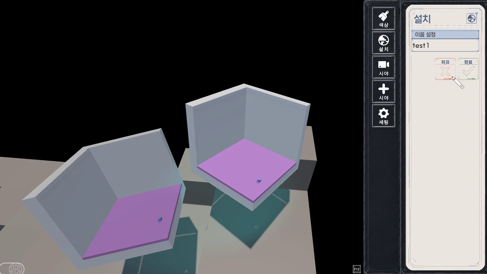
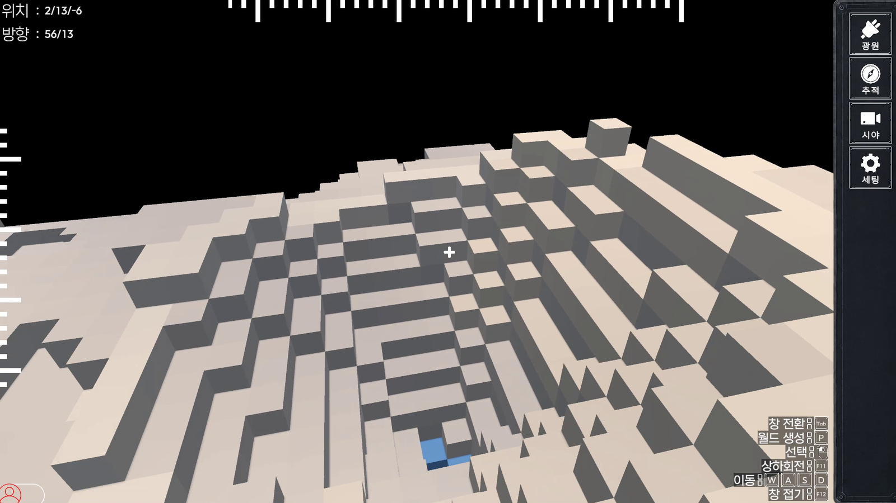
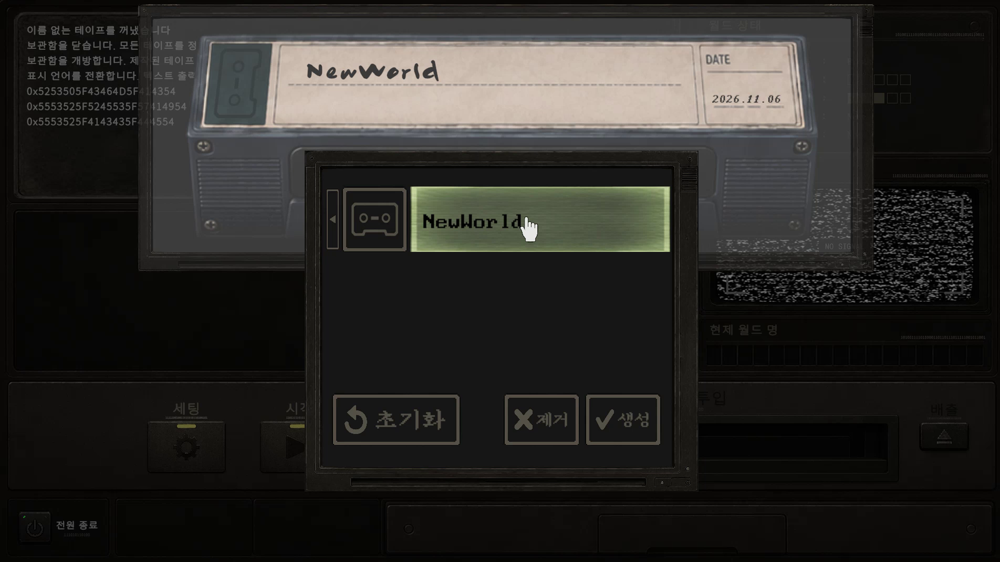
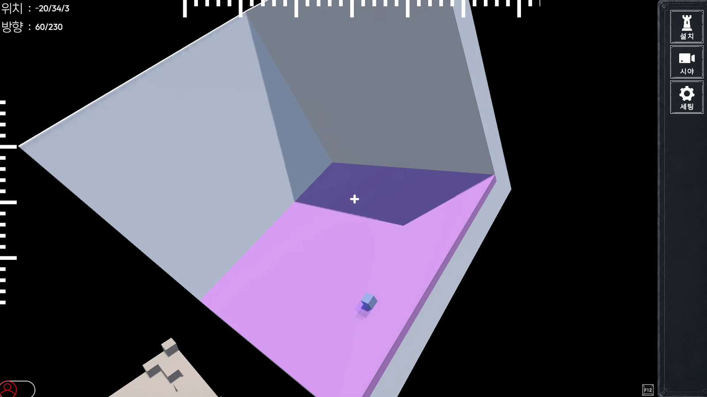
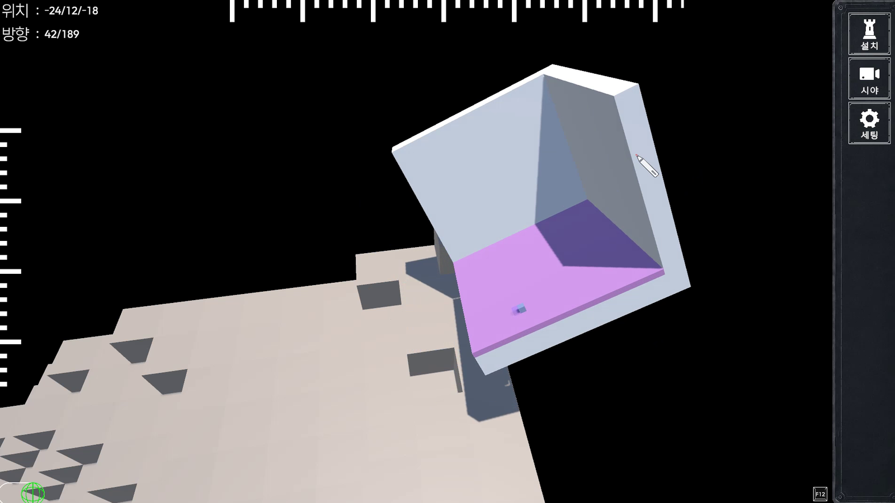
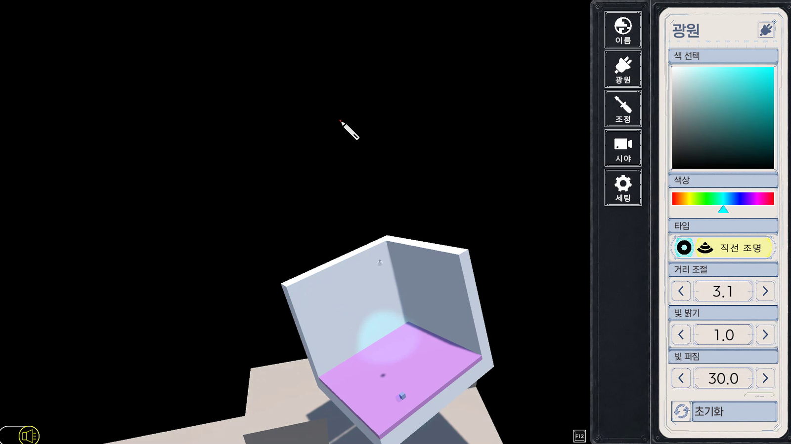
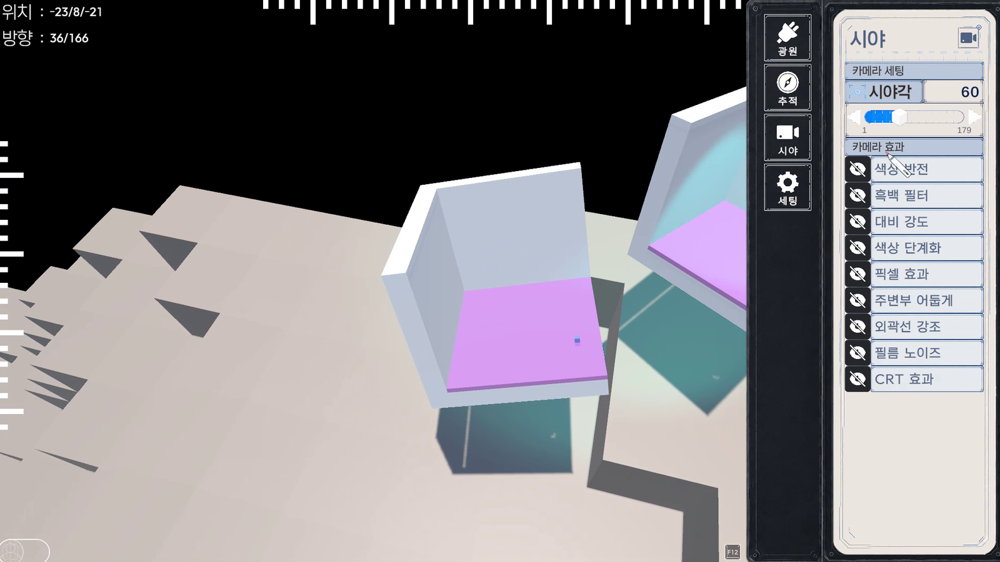
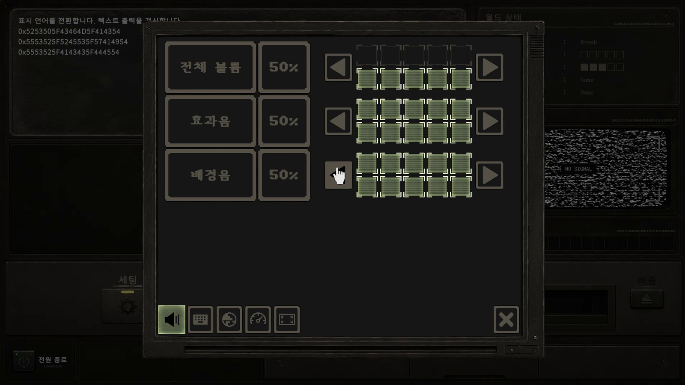

# NewWorld

<p align="center">
  
</p>

<p align="center">
  Unity와 C#으로 제작 중인 개인 3D 월드 제작·편집 프로젝트
</p>

## 소개

**NewWorld**는 플레이어가 월드를 생성하고, 배치하고, 색상과 조명을 수정하며 자신만의 공간을 구성할 수 있도록 제작 중인 Unity 프로젝트입니다.

월드 자체를 하나의 편집 대상으로 다루며, 플레이어 조작과 월드 조작을 전환하면서 위치·회전·크기·블록·색상·광원 등을 직접 수정할 수 있도록 구성하고 있습니다.

현재도 개발 중이며 기능과 UI는 계속 개선되고 있습니다.

---

## 주요 기능

### 월드 생성 및 관리

<p align="center">
  
</p>

- 여러 월드를 생성하고 각각 독립적으로 관리
- 생성된 월드를 선택해 편집 모드로 진입
- 월드 저장 및 불러오기
- 테이프 형태의 UI를 이용한 월드 데이터 관리

<p align="center">
  
</p>

### 월드 편집

<p align="center">
  
</p>

- 월드 이동
- 월드 회전
- 월드 크기 조절
- 블록 설치 및 파괴
- 범위 선택
- 선택 잠금
- 표면에 맞춰 월드 배치
- 색상 추출 및 적용

<p align="center">
  
</p>

### 색상 및 조명

<p align="center">
  
</p>

- 색상 UI를 통한 색상 선택 및 적용
- 기존 오브젝트의 색상 추출
- 광원 색상 조정
- 광원 위치 및 각종 조명 속성 조정
- 월드별 조명 연출 구성

### 플레이어 / 월드 / 빛 조작 전환

상황에 따라 조작 대상을 전환할 수 있습니다.

- Player
- World
- Light

동일한 키라도 현재 상태에 따라 다른 동작을 수행하도록 구성되어 있습니다.

### 상황별 조작 안내 — CanControl

현재 `GameFlow`, 선택 중인 UI, 조작 대상 상태에 따라 사용할 수 있는 키를 화면에 자동으로 표시합니다.

- 상태에 맞는 조작키만 표시
- 키 설정 변경 시 표시도 함께 갱신
- 키보드 / 마우스 입력 아이콘 지원
- `F12`로 조작 설명 UI 접기 / 펼치기
- 접힘 상태 저장 및 다음 실행 시 복원

### 키 설정

<p align="center">
  
</p>

게임에서 사용하는 주요 키를 직접 변경할 수 있습니다.

키 설정 데이터는 실제 게임 입력과 CanControl UI에 함께 반영됩니다.

### 게임 설정

<p align="center">
  
</p>

- 해상도 설정
- 전체 화면 / 창 모드
- 사운드 설정
- 입력키 설정
- 기타 플레이 환경 설정

---

## 사용 기술

- **Unity**
- **C#**
- **TextMeshPro**
- **DOTween**
- **ScriptableObject**
- **Coroutine**
- **Raycast**
- **JSON 기반 설정 및 저장 데이터**
- **Git / GitHub**

프로젝트 내부에서는 월드·UI·입력·저장 시스템을 각각 Manager 및 ScriptableObject 기반 구조로 나누어 관리하고 있습니다.

---

## 다운로드

Windows 빌드는 GitHub의 **Releases**에서 배포할 예정입니다.

[NewWorld Releases](https://github.com/Yun-Jiyeol/NewWorld/releases)

압축 파일을 다운로드한 뒤 압축을 해제하고 실행 파일을 실행하면 됩니다.

---

## 프로젝트 구조

```text
NewWorld/
├─ Assets/
│  ├─ Script/
│  ├─ Prefab/
│  ├─ ScriptableObject/
│  └─ ...
├─ Packages/
├─ ProjectSettings/
├─ README_Images/
└─ README.md
```

---

## 개발 상태

현재 개발 중인 프로젝트입니다.

기능 추가뿐 아니라 UI, 조작 방식, 최적화, 저장 구조 등을 계속 수정하고 있습니다.

---

## Developer

**Yun-Jiyeol**

Unity / C# Game Developer
