# NewWorld

  

  <b>Unity / C# 기반 3D 월드 생성·편집 프로젝트</b>

## 프로젝트 소개

**NewWorld**는 월드를 직접 생성하고 공간에 배치한 뒤, 블록·색상·조명·위치 등을 계속 수정해 나가는 개인 개발 프로젝트입니다.

하나의 고정된 맵만 플레이하는 방식이 아니라 여러 개의 월드를 만들고 각각을 하나의 편집 대상으로 관리하는 것을 목표로 제작하고 있습니다.  
플레이 중에는 현재 상황에 맞는 조작키를 확인하면서 월드 생성, 블록 편집, 색상 지정, 조명 제작, 월드 이동과 추적 등을 수행할 수 있습니다.

> 현재 개발 중인 프로젝트로 기능과 UI는 계속 변경·개선되고 있습니다.

---

## 다운로드

Windows 빌드는 GitHub Releases에서 받을 수 있습니다.

**[▶ 최신 NewWorld 빌드 다운로드](https://github.com/Yun-Jiyeol/NewWorld/releases/latest)**

압축 파일을 해제한 뒤 실행 파일을 실행하면 됩니다.

---

# 주요 기능

## 1. 메인 페이지

  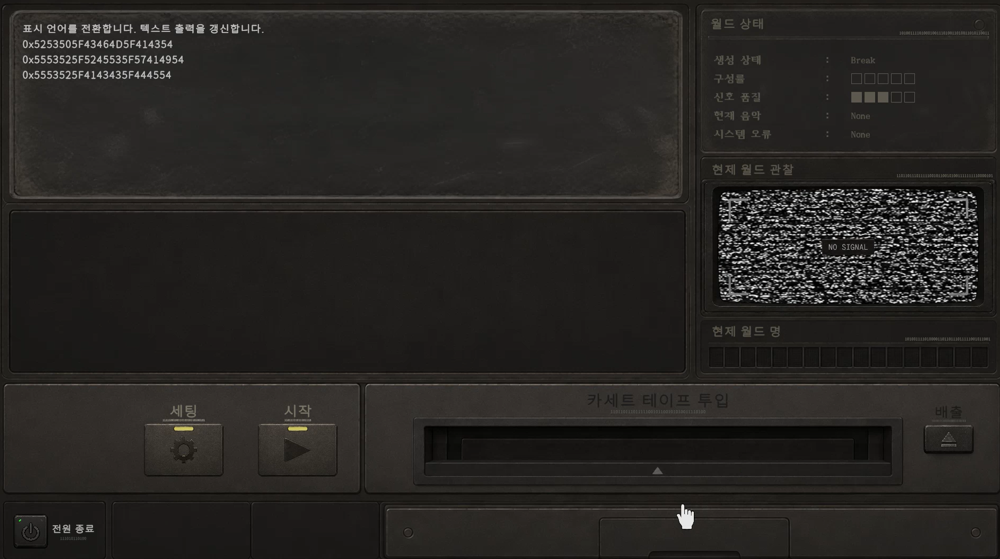

게임을 시작하기 전 현재 상태와 세이브 데이터를 관리하는 메인 화면입니다.

- 현재 월드 상태 확인
- 현재 월드 관찰 화면 표시
- 현재 월드 이름 확인
- 설정 메뉴 진입
- 선택한 세이브 파일로 게임 시작
- 카세트 테이프 형태의 세이브 관리 시스템 진입
- 시스템 메시지와 상태 로그 확인

---

## 2. 카세트 테이프 기반 저장 / 불러오기

NewWorld의 세이브 데이터는 **카세트 테이프 형태의 UI**를 통해 관리합니다.

### 세이브 파일 확인

  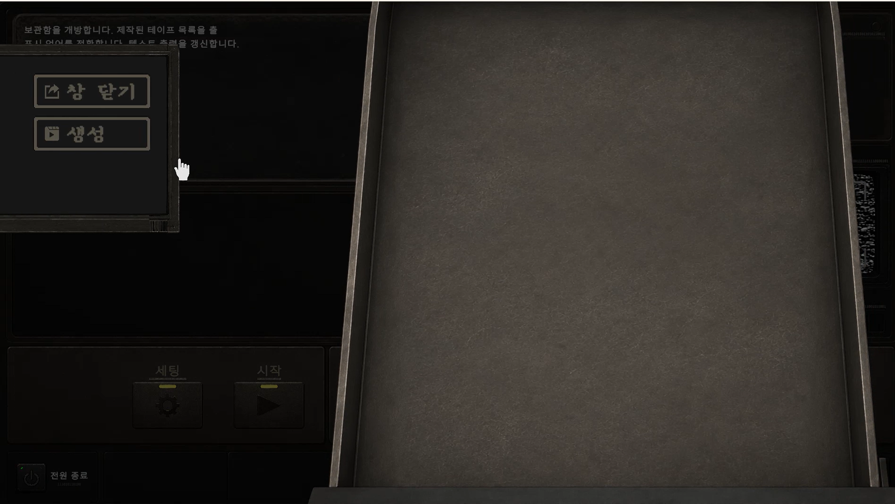

- 생성된 세이브 파일 목록 확인
- 새로운 세이브 생성
- 보관함에서 원하는 세이브 선택 및 관리

### 세이브 파일 생성

  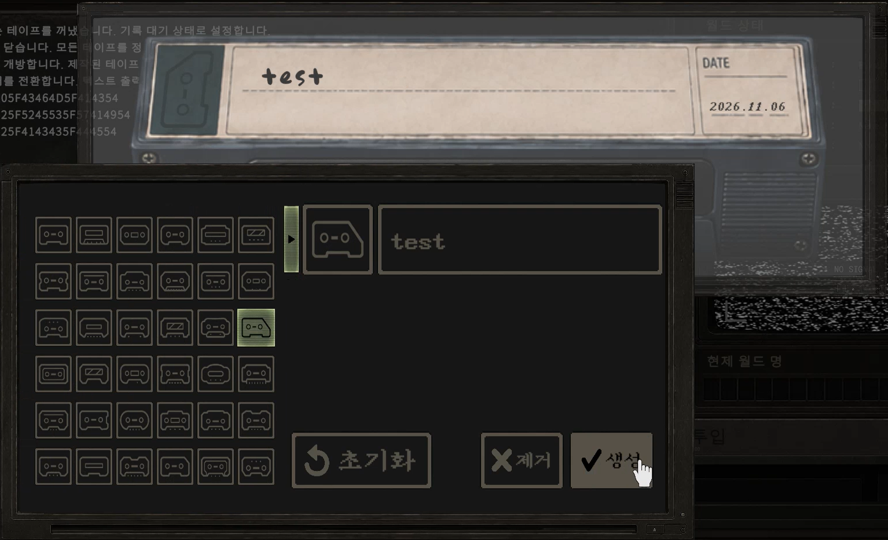

- 세이브 이름 직접 지정
- 여러 카세트 외형 중 원하는 디자인 선택
- 생성 날짜 표시
- 선택 내용을 초기화하거나 취소한 뒤 다시 제작 가능

### 세이브 선택 및 적용

  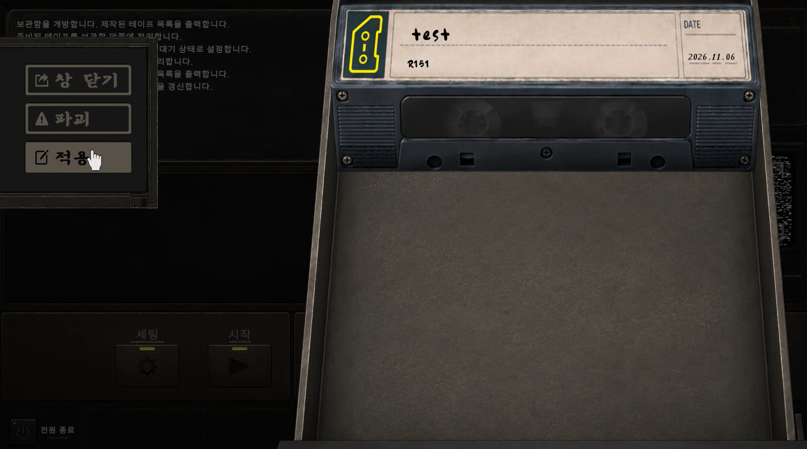

선택한 카세트의 이름과 정보를 확인한 뒤 해당 세이브를 적용할 수 있습니다.

### 선택한 세이브 열기

  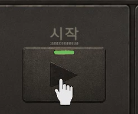

메인 페이지의 **시작 버튼**을 누르면 현재 선택된 세이브 파일을 기준으로 게임을 시작합니다.

### 불러오기 완료

  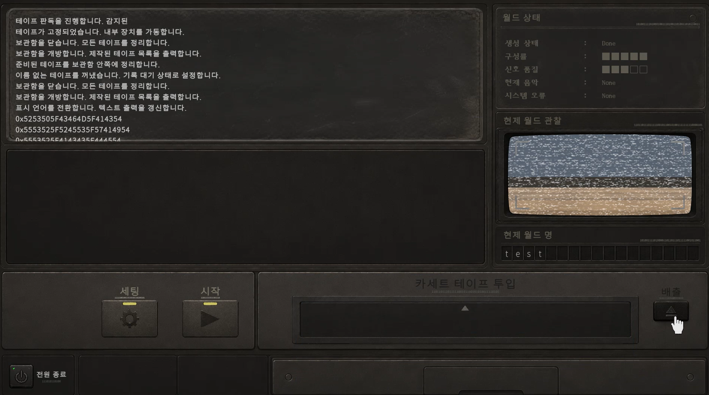

불러온 데이터에 따라 현재 월드 이름과 월드 관찰 화면 등이 갱신됩니다.

### 세이브 삭제

  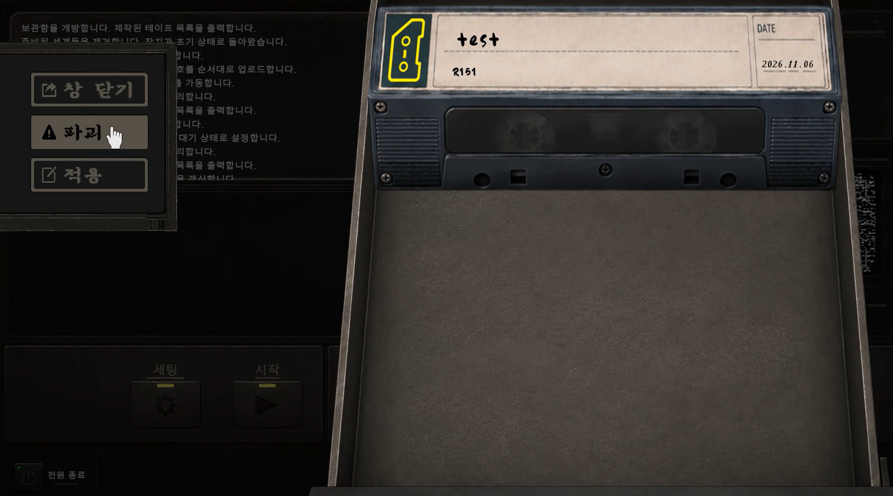

필요 없는 카세트 세이브는 보관함에서 선택한 뒤 삭제할 수 있습니다.

---

## 3. 월드 생성

  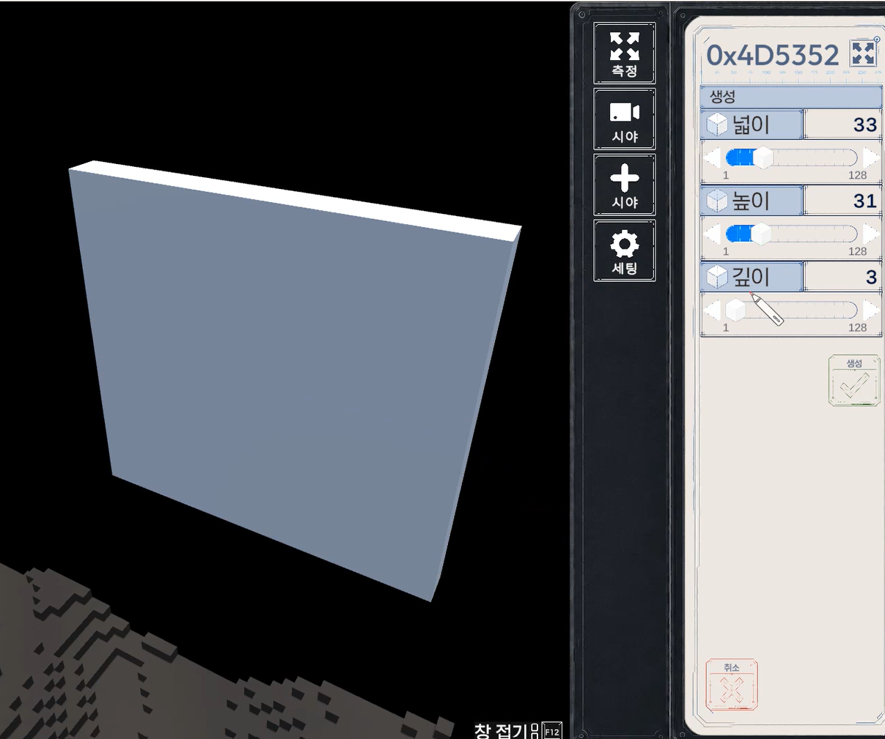

새로운 월드를 만들 때 가로·세로·깊이를 직접 설정할 수 있습니다.

- Width / Height / Depth 개별 설정
- 각 축의 크기를 **최대 128**까지 설정
- 슬라이더와 수치 표시를 이용한 크기 조정
- 생성 전 월드 크기 미리 확인

### 월드 이름 지정

  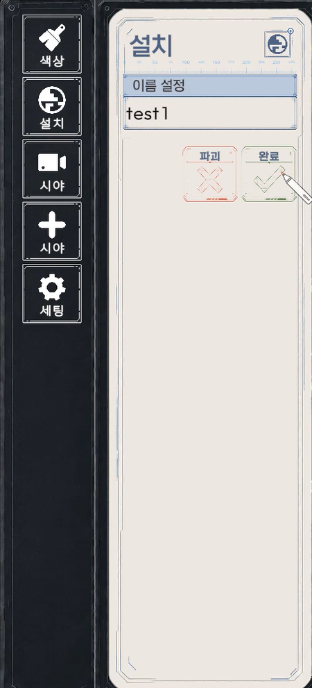

생성한 월드에는 원하는 이름을 지정할 수 있으며, 해당 이름은 이후 월드를 구분하고 관리할 때 사용됩니다.

### 제작한 월드 배치

  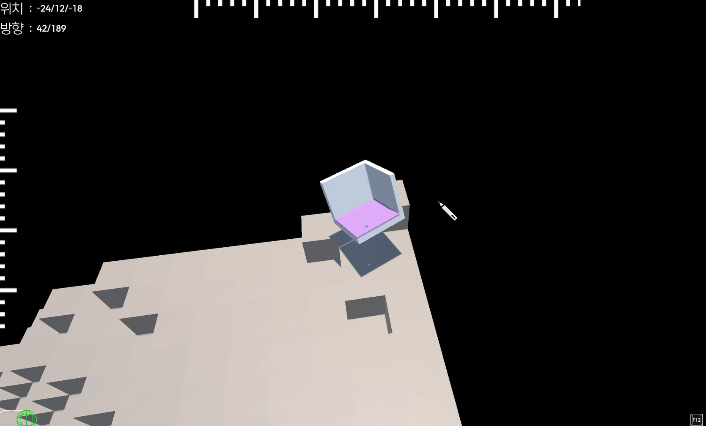

생성이 끝난 월드를 실제 공간에 배치합니다.

- 설치 전 위치 확인
- 위치와 방향을 조절한 뒤 설치
- 기존 월드 주변 또는 위에 새로운 월드를 추가해 공간 확장

---

## 4. 블록 선택 및 편집

### 개별 선택 / 범위 선택

  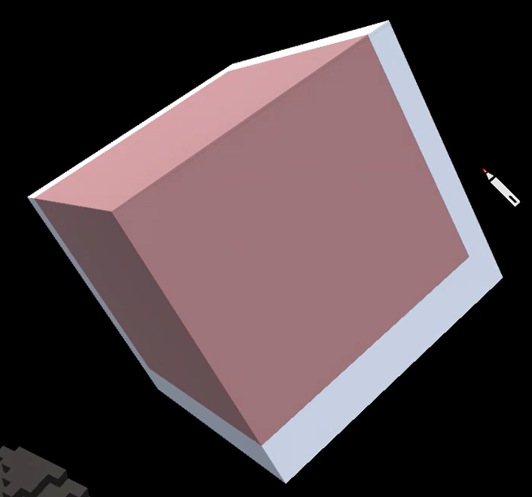
  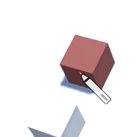

- 블록을 하나씩 개별 선택
- 여러 블록을 범위 단위로 선택
- 선택된 대상을 시각적으로 구분
- 선택 상태를 기반으로 설치·삭제·색상 편집 등의 작업 수행

### 블록 설치 / 삭제

  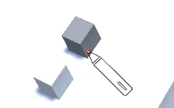
  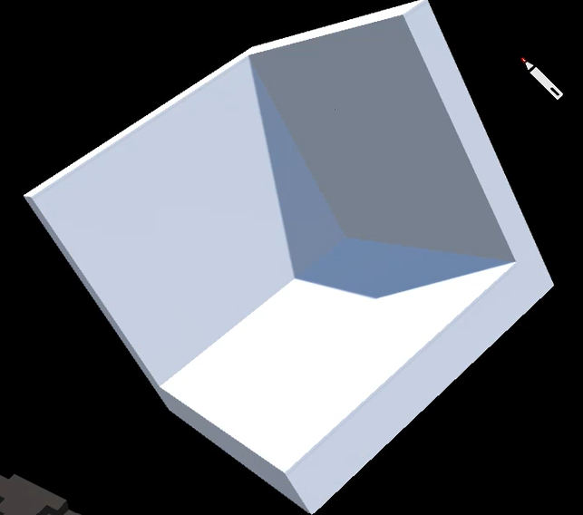

월드에 새로운 블록을 추가하거나 기존 블록을 제거하여 형태를 직접 수정할 수 있습니다.

- 원하는 위치에 블록 설치
- 선택한 블록 삭제
- 개별 선택과 범위 선택을 편집 작업과 연계

---

## 5. 색상 편집

  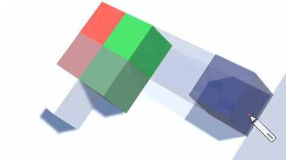
  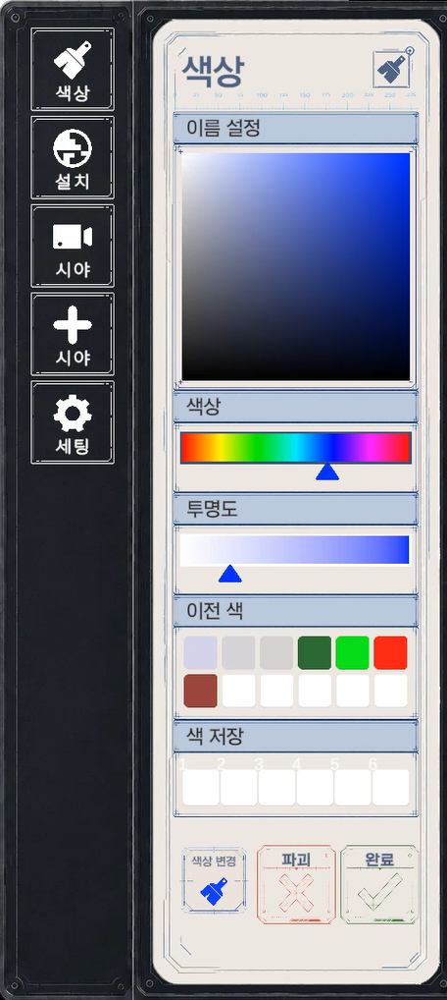

블록과 오브젝트의 색상을 직접 선택하고 적용할 수 있습니다.

- 색상 영역에서 직접 색 선택
- Hue 조절
- 투명도 조절
- 이전에 사용한 색 확인
- 자주 사용하는 색을 슬롯에 저장
- 저장한 색을 빠르게 다시 호출
- 선택한 블록 또는 새로 설치하는 블록에 색상 적용
- 기존 대상의 색을 추출하여 다른 대상에 활용

---

## 6. 상황별 조작 안내

  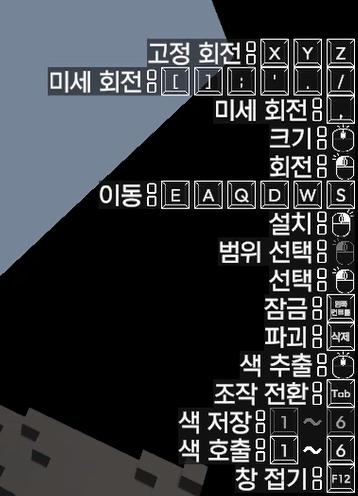
  

현재 상황에서 사용할 수 있는 조작키를 화면에 표시하는 **CanControl UI**입니다.

- 현재 플레이 상태에 따라 필요한 조작만 표시
- 이동 / 회전 / 설치 / 선택 / 범위 선택 / 잠금 / 파괴 / 색 추출 등 안내
- Player / World / Light 등 현재 조작 대상에 맞춰 표시 내용 변경
- 키 설정에서 변경한 키도 안내 UI에 함께 반영
- `F12`로 안내창 접기 / 펼치기
- 접었을 때는 `F12`만 남겨 플레이 화면을 최소한으로 가림

---

## 7. 월드 관리

### 위치 수정 / 복사 / 제거

  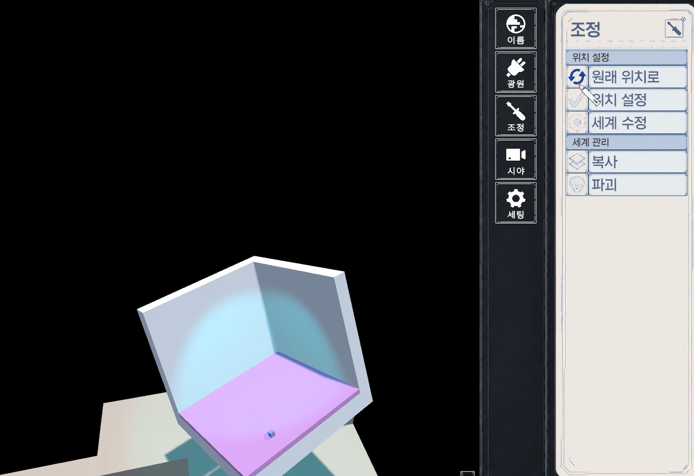

생성이 끝난 월드도 이후 다시 관리할 수 있습니다.

- 월드 위치 수정
- 원래 위치로 되돌리기
- 기존 월드 복사
- 필요 없는 월드 제거

### 원하는 월드 추적

  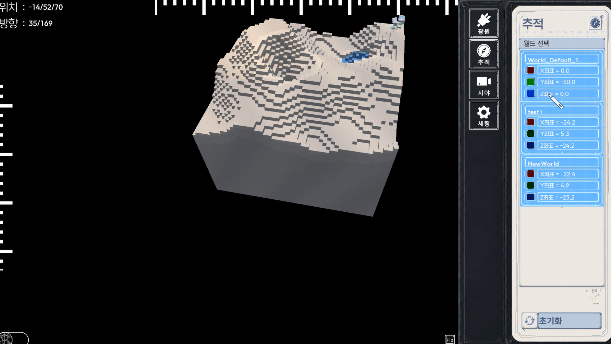

여러 월드가 존재할 때 원하는 월드를 선택하고 위치를 파악할 수 있습니다.

- 월드 이름별 목록 표시
- 각 월드의 X / Y / Z 좌표 확인
- 원하는 월드를 선택해 추적
- 여러 월드가 멀리 분산되어 있어도 위치 파악 가능

---

## 8. 개인 월드 조명

  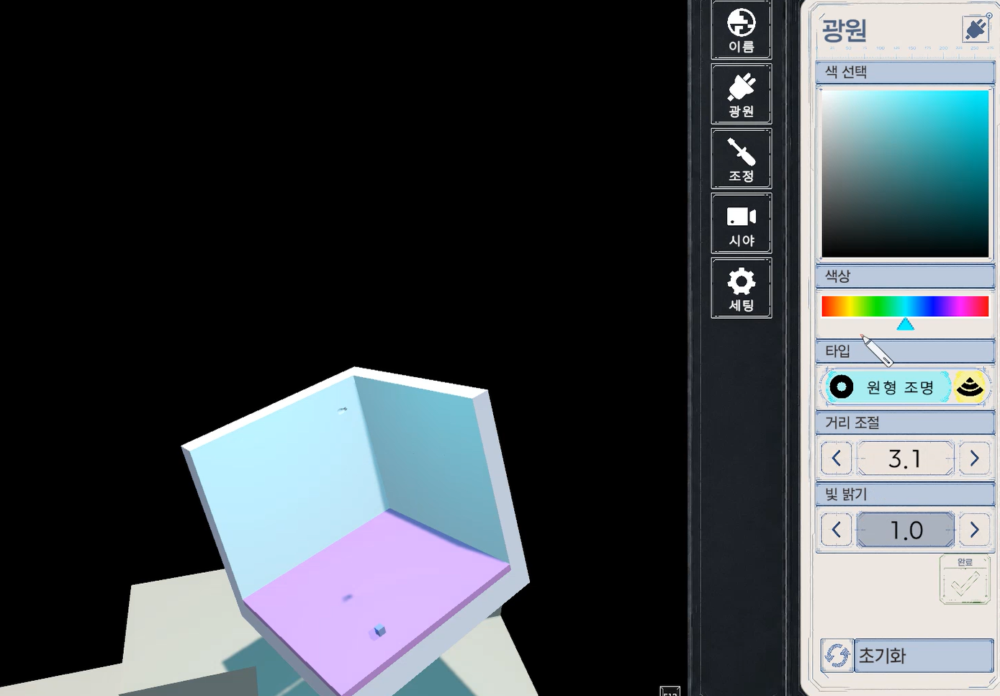
  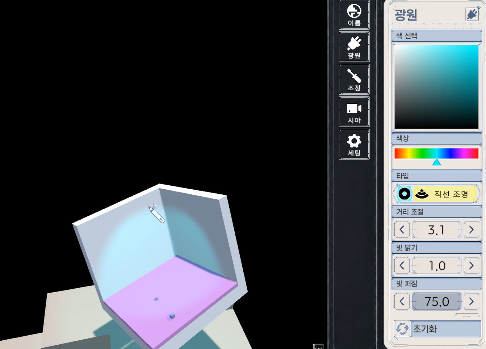

각 월드에 개별적으로 광원을 제작하고 조정할 수 있습니다.

- 광원 색상 선택
- **원형 조명 / 직선 조명** 타입 전환
- 광원 거리 조절
- 빛 밝기 조절
- 직선 조명의 빛 퍼짐 조절
- 설정 초기화
- 조명 변경 결과를 월드에 바로 반영

이를 이용해 월드마다 서로 다른 분위기와 시각적 연출을 구성할 수 있습니다.

---

## 9. 카메라 / 화면 효과

  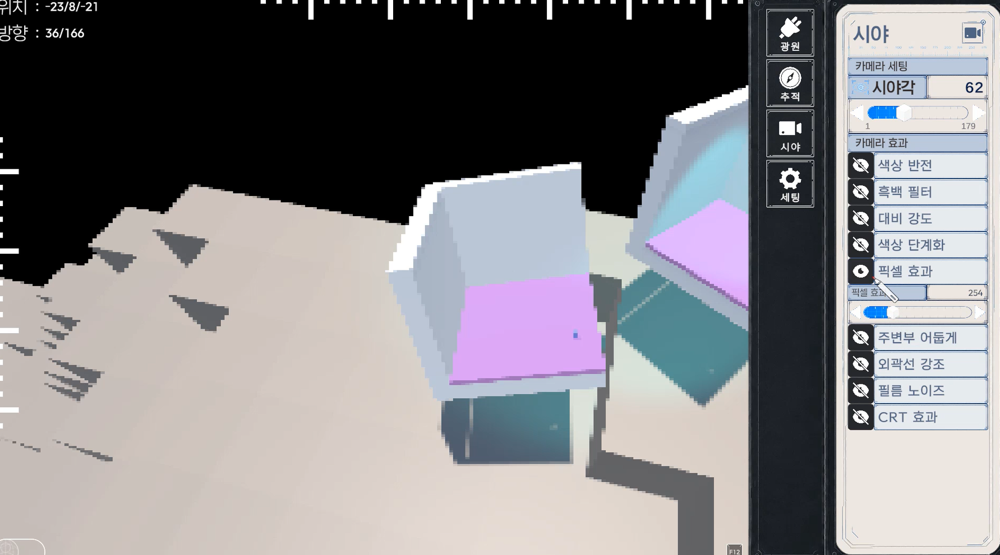

플레이 화면의 시야와 시각 효과를 직접 변경할 수 있습니다.

- 카메라 시야각(FOV) 조절
- 색상 반전
- 흑백 필터
- 대비 강도
- 색상 단계화
- 픽셀 효과 및 픽셀 강도
- 주변부 어둡게
- 외곽선 강조
- 필름 노이즈
- CRT 효과

각 효과를 개별적으로 켜고 끌 수 있어 원하는 화면 분위기를 구성할 수 있습니다.

---

# 게임 설정

## 언어 설정

  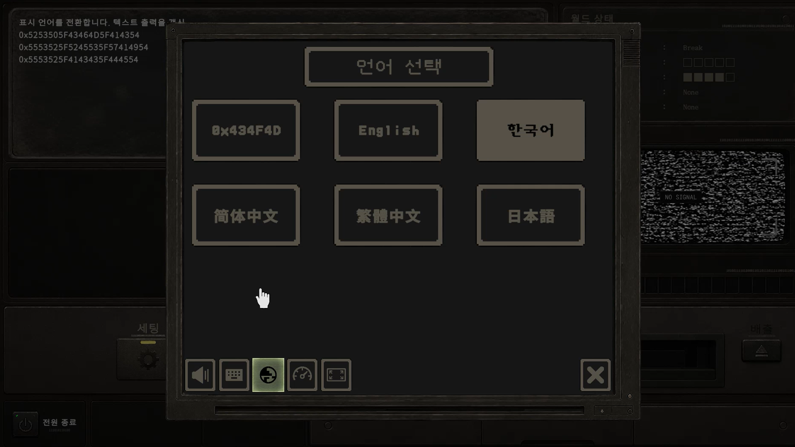

지원 언어:

- 한국어
- English
- 简体中文
- 繁體中文
- 日本語

게임 내 설정에서 표시 언어를 변경할 수 있습니다.

## 사운드 설정

  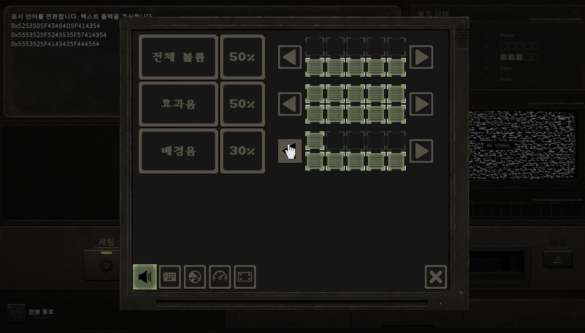

- 전체 볼륨
- 효과음
- 배경음

각 항목을 단계별로 조절할 수 있습니다.

## 키 설정

  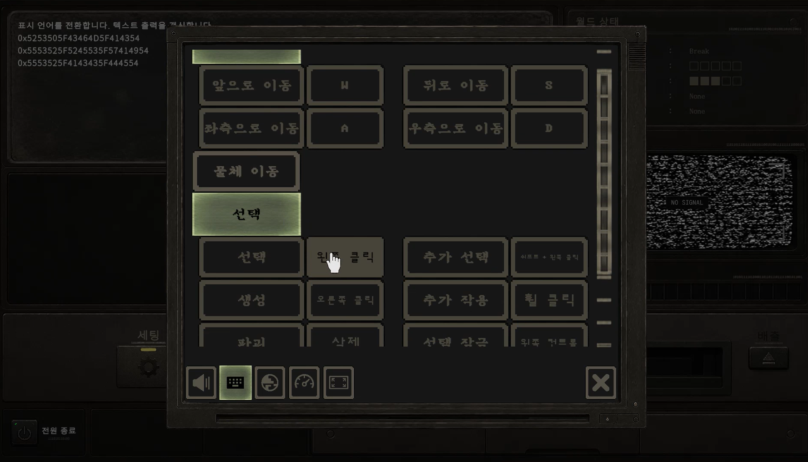

게임에서 사용하는 주요 키를 직접 변경할 수 있습니다.

- 이동
- 선택 / 추가 선택
- 생성 / 설치
- 삭제
- 회전
- 기타 월드 편집 기능
- 키보드와 마우스 입력 설정

변경된 키는 실제 조작과 CanControl 안내 UI에 함께 반영됩니다.

## 화면 크기 설정

  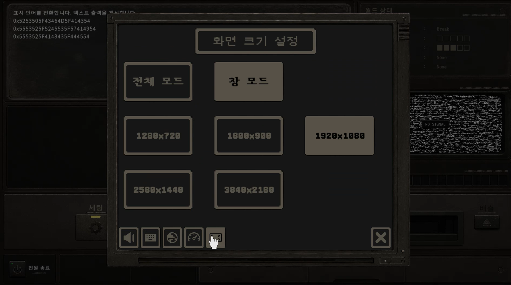

- 전체 화면 / 창 모드
- 1280×720
- 1600×900
- 1920×1080
- 2560×1440
- 3840×2160

## 조작 감도 / 속도 설정

  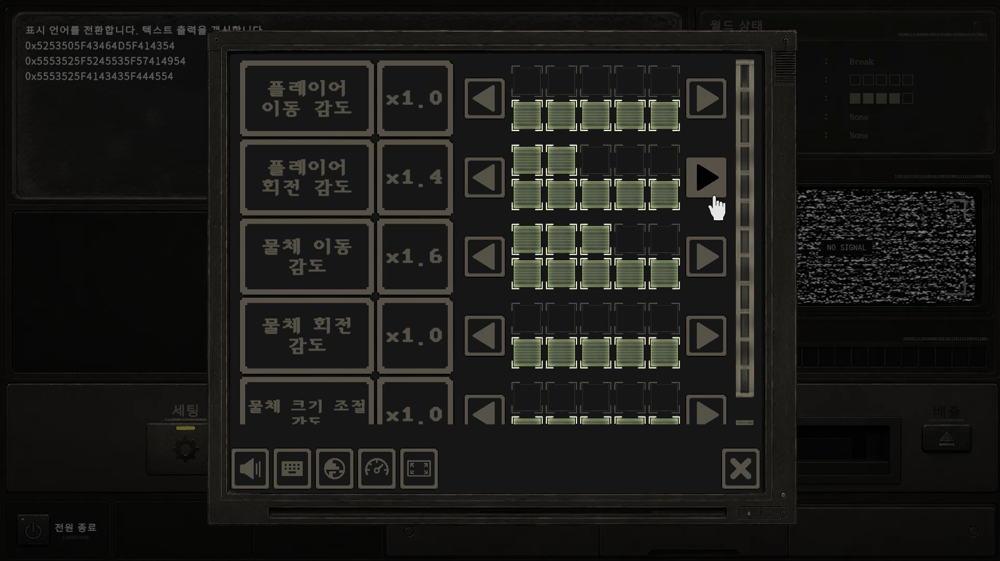

- 플레이어 이동 감도
- 플레이어 회전 감도
- 물체 이동 감도
- 물체 회전 감도
- 물체 크기 조절 감도

플레이 스타일에 맞춰 각 조작의 반응 속도를 개별적으로 조절할 수 있습니다.

---

# 사용 기술

- **Unity**
- **C#**
- **TextMeshPro**
- **DOTween**
- **ScriptableObject**
- **Coroutine**
- **Raycast**
- **JSON 기반 설정 / 저장 데이터**
- **Git / GitHub**

프로젝트 내부에서는 입력, 월드, UI, 저장, 카메라 등의 기능을 여러 Manager와 ScriptableObject 기반 데이터로 나누어 관리하고 있습니다.

---

# 전체 기능 영상 보기

아래 이미지를 누르면 기능을 순서대로 촬영한 전체 영상으로 이동합니다.

  <a href="https://github.com/Yun-Jiyeol/NewWorld/releases/latest/download/NewWorld_Feature_Demo.mp4">
    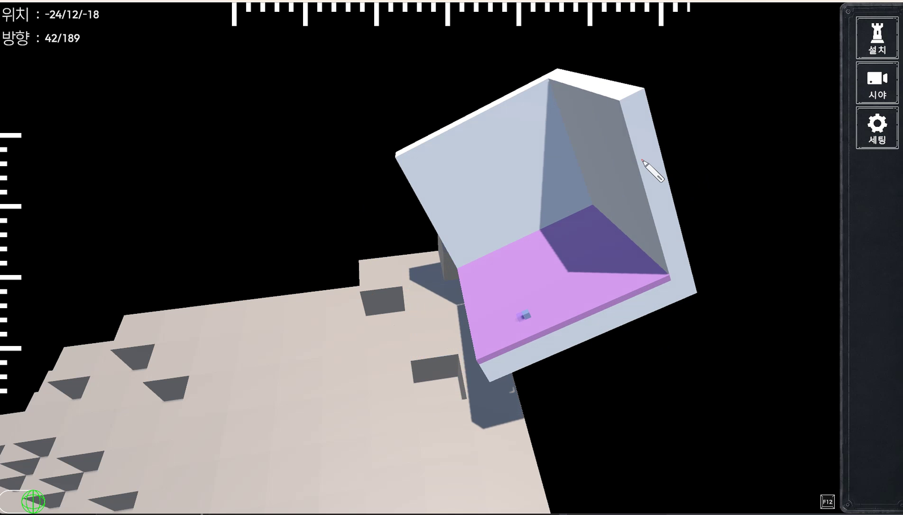
  </a>

  <b><a href="https://github.com/Yun-Jiyeol/NewWorld/releases/latest/download/NewWorld_Feature_Demo.mp4">▶ NewWorld 전체 기능 영상 보기</a></b>
   
  <a href="https://github.com/Yun-Jiyeol/NewWorld/releases/latest">GitHub Release 페이지 열기</a>

> 영상 링크를 사용하려면 최신 GitHub Release에  
> `NewWorld_Feature_Demo.mp4`라는 이름으로 영상을 첨부하면 됩니다.

---

# 개발 상태

현재 **개발 중**입니다.

월드 제작 기능, UI, 조작 방식, 저장 시스템, 최적화 등을 계속 수정하고 있으며 개발 진행에 따라 README의 내용도 갱신할 예정입니다.

---

## Developer

**Yun-Jiyeol**  
Unity / C# Game Developer
